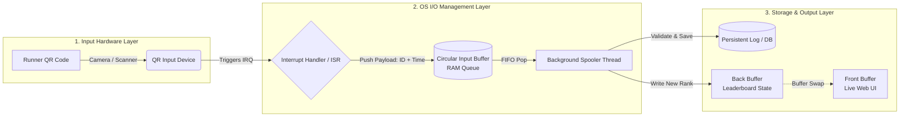
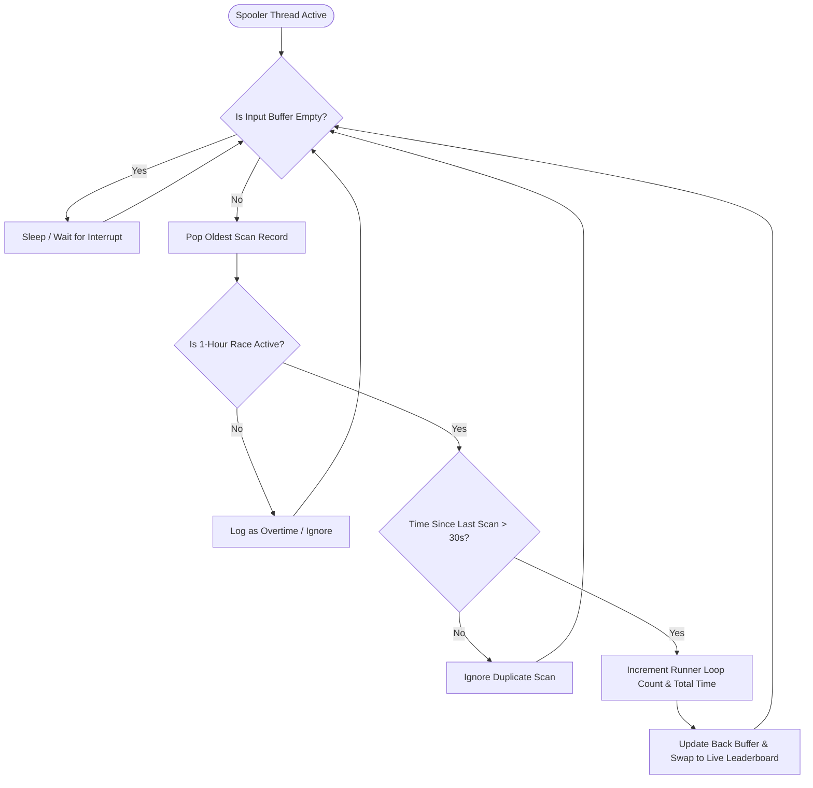

# System Architecture & OS I/O Flow (Week 5)

## 1. High-Level System Architecture
This diagram illustrates how physical QR scan events are processed as OS Hardware Interrupts, queued in an in-memory Circular Buffer, and processed asynchronously by a background Spooler thread to update the Live Leaderboard.

## 2. Spooler & Loop Validation Flowchart
To prevent accidental double-scans (e.g., a runner holding their QR code in front of the scanner for 3 seconds), the Spooler thread enforces a debounce threshold before incrementing the loop count.

## 3. Selected Development Tools
* **Core Engine:** Python 3.10+ (`threading`, `queue.Queue`, `time`)
* **I/O Input Simulation & Capture:** OpenCV + `pyzbar` (Webcam QR Reader) & Multi-threaded Stress Tester
* **Live Leaderboard Interface:** Flask Web Server + HTML/JavaScript (Auto-refreshing Front Buffer)
